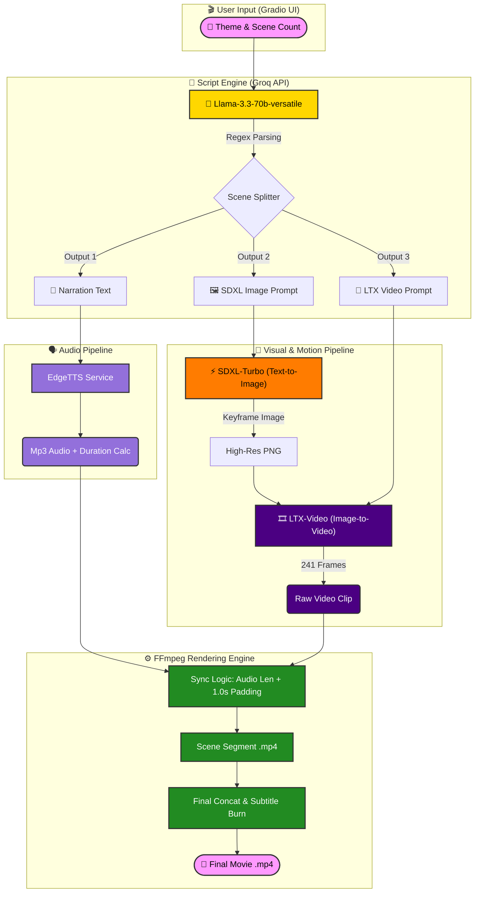

# 🎬 Nano Cinema AI Video Studio

[](https://github.com/wajason/Nano_Cinema_AI_Video_Studio/stargazers)
[](https://github.com/wajason/Nano_Cinema_AI_Video_Studio/network/members)
[](./LICENSE)
[](https://colab.research.google.com/github/wajason/Nano_Cinema_AI_Video_Studio/blob/main/Nano_Cinema_AI_Video_Studio.ipynb)


[](https://www.python.org/)
[](https://pytorch.org/)
[](https://gradio.app/)
[](https://ffmpeg.org/)
[](https://developer.nvidia.com/cuda-toolkit)

[](https://ai.meta.com/llama/)
[](https://huggingface.co/stabilityai/sdxl-turbo)
[](https://huggingface.co/Lightricks/LTX-Video)
[]()

<br>

**An open-source, end-to-end AI video production pipeline optimized for 8GB VRAM consumer GPUs.**     
We aim to solve resource constraints by combining efficient open-source models to achieve a **"free and unlimited"** video production workflow that **runs smoothly on consumer-grade hardware**.

If you find this project interesting, please give it a ⭐ **Star**! Thanks!!🙏🙏🙏

## 📑 Table of Contents
- [🚀 Workflow Overview](#-workflow-overview)
- [🎬 Demo Showcase](#-demo-showcase)
- [📷 UI Screenshot](#-ui-screenshot)
- [🌟 Background & Motivation](#-background--motivation)
- [🛠️ Technology Stack](#-technology-stack)
- [📦 Getting Started](#-getting-started)
- [📘 User Guide](#-user-guide)
- [🔭 Roadmap & Vision](#-roadmap--vision)
- [🙏 Acknowledgements](#-acknowledgements)
- [📈 Star History](#-star-history)🙏

## 🚀 Workflow Overview

This project implements a complete generative AI pipeline orchestrated via a **Gradio Web UI**, allowing users to create short films from simple text prompts entirely locally (with API support for text).

> **Script** (Llama-3.3-70b-versatile via Groq) ➡️ **Images** (SDXL-Turbo) ➡️ **Audio** (EdgeTTS) ➡️ **Video** (LTX) ➡️ **Composition** (FFmpeg)



---

## 🎬 Demo Showcase

### 1. Interstellar Hamster: The Search for the Giant Carrot Planet 🐹🥕
<table>
  <tr>
    <td width="50%" style="vertical-align: middle;">
      <video src="https://github.com/user-attachments/assets/8e2070a1-6ecf-4a51-bde9-47150836fb4e" controls width="100%" style="display:block; margin: 0 auto;"></video>
    </td>
    <td width="50%" style="vertical-align: middle; text-align: center;">
       
      <br>
       
    </td>
  </tr>
</table>

### 2. The Flying Pig's Guide to Success: Find Your Wind! 🐷✈️
<table>
  <tr>
    <td width="50%" style="vertical-align: middle;">
      <video src="https://github.com/user-attachments/assets/b82fdf76-8a84-48d9-bb14-0a2b38efedc0" controls width="100%" style="display:block; margin: 0 auto;"></video>
    </td>
    <td width="50%" style="vertical-align: middle; text-align: center;">
       
      <br>
       
    </td>
  </tr>
</table>

### 3. More Demos 📺
Here are some additional generated results:
<table>
  <tr>
    <td width="33%"><video src="https://github.com/user-attachments/assets/f83e6bed-9c64-47ff-a08b-dbef0dc9674e" controls width="100%"></video></td>
    <td width="33%"><video src="https://github.com/user-attachments/assets/76487bfb-ca15-47bc-b749-da56179bc5c7" controls width="100%"></video></td>
    <td width="33%"><video src="https://github.com/user-attachments/assets/2b5db194-41d7-4292-9f7f-55598e5664f9" controls width="100%"></video></td>
  </tr>
</table>

---

## 📷 UI Screenshot

Here is a walkthrough of the generation pipeline using the Gradio UI:

| **1. Script Generation** | **2. Image Generation** |
| :---: | :---: |
|  <br> *Generates scripts using Llama-3.3-70b* |  <br> *Visualizes scenes using SDXL-Turbo* |
| **3. Audio Generation** | **4. Video Generation** |
|  <br> *Synthesizes narration via EdgeTTS* |  <br> *Animates video with LTX & FFmpeg* |

---

## 🌟 Background & Motivation

The 2025 Google I/O Developer Conference showcased groundbreaking advancements in AI, particularly the **Veo3 model** and **Flow platform**, demonstrating cinema-quality text-to-movie generation. While impressive, **these proprietary tools often come with high costs or restricted access**.

**Our Mission:**
The goal of **Nano Cinema AI Video Studio** is to **democratize AI video creation**. We aim to solve resource constraints by combining efficient open-source models to achieve a **"free and unlimited"** video production workflow that runs smoothly on consumer-grade hardware.

* ✅ **Hardware Tested:** NVIDIA GeForce RTX 4060 (8GB VRAM) *1
* ✅ **Result:** High-quality image and video generation without requiring enterprise-level GPUs.

---

## <a id="-technology-stack"></a>🛠️ Technology Stack

We carefully selected components to balance **performance, cost, and speed**:

1.  **Script Generation: Llama-3.3-70b-versatile (via Groq)**
    * Utilizes Groq's LPU technology for lightning-fast, free inference. Llama-3.3 offers exceptional creative writing capabilities and multilingual support.

2.  **Image Generation: SDXL-Turbo**
    * Powered by Adversarial Diffusion Distillation (ADD), generating high-quality cinematic shots in just **1-4 steps**. Implemented via Hugging Face `diffusers`.

3.  **Audio Synthesis: EdgeTTS**
    * Accesses Microsoft Edge's natural-sounding speech synthesis. Requires **no API key**, no heavy downloads, and offers granular control over pitch and speed.

4.  **Video Generation: LTX (Image-to-Video)**
    * A breakthrough in local generative video. LTX offers low latency and high computational efficiency, making it possible to generate video clips on 8GB VRAM cards.

5.  **Interface: Gradio**
    * Provides a user-friendly Web UI for real-time preview, script editing, and partial re-rendering (inpainting/regeneration) support.

---

## 📦 Getting Started

Follow these steps to set up **Nano Cinema AI Video Studio** on your local machine. This project is designed to run completely offline using local resources.

### 📋 Prerequisites

* **Operating System:** Windows 10/11 (Recommended) or Linux.
* **Python:** Version 3.10 or higher.
* **GPU:** NVIDIA GeForce RTX 4060 or higher (VRAM 8GB+ is required).
* **FFmpeg:** Required for video processing and audio merging.

### 🛠️ Installation

**1. Clone the repository**

```bash
git clone https://github.com/wajason/Nano_Cinema_AI_Video_Studio.git
cd Nano_Cinema_AI_Video_Studio
```

**2. Set up a Virtual Environment**

It is highly recommended to use a virtual environment to manage dependencies to avoid conflicts.

* **Windows:**

    ```bash
    python -m venv venv
    .\venv\Scripts\activate
    ```

* **Linux / macOS:**

    ```bash
    python3 -m venv venv
    source venv/bin/activate
    ```

**3. Install Dependencies**

First, install PyTorch with CUDA support specifically for your GPU (this ensures GPU acceleration works correctly).

* **Example for CUDA 12.4:**

    ```bash
    pip install torch torchvision torchaudio --index-url https://download.pytorch.org/whl/cu124
    ```

    *(Note: Visit [pytorch.org](https://pytorch.org) to find the correct command for your specific CUDA version.)*

Then, install the rest of the project requirements:

```bash
pip install -r requirements.txt
```

### 📥 Model Setup

We provide an automated script to download the necessary model weights (SDXL-Turbo for images and LTX-Video for motion) directly into the project folder. This ensures relative paths work correctly without cluttering your global system drive.

**Run the download script:**

```bash
python download_models.py
```

> **Note:** This process will download several gigabytes of data into the `models/` directory. Please ensure you have sufficient disk space and a stable internet connection.

### ⚙️ FFmpeg Configuration

This studio requires FFmpeg to stitch video clips and audio tracks. You have two options:

* **Option A (System-wide):** Install FFmpeg and add it to your system's `PATH` environment variable.
* **Option B (Portable - Recommended for Windows):** Download `ffmpeg.exe` and `ffprobe.exe` (from [gyan.dev](https://www.gyan.dev/ffmpeg/builds/)) and place them directly inside the project root folder. The notebook is configured to detect them automatically.

### 🚀 Launching the Studio

Since this project is built as an interactive Jupyter Notebook (`.ipynb`), you need to launch it using Jupyter Lab or Notebook.

**Start Jupyter:**

```bash
jupyter lab
# OR
jupyter notebook
```

**Open the Notebook:**
In the browser window that opens, navigate to and click on `Nano_Cinema_AI_Video_Studio.ipynb`.

**Run the Application:**
Execute the cells sequentially from top to bottom. The final cell will launch the Gradio UI and provide a local URL (e.g., `http://127.0.0.1:7860`) where you can start creating movies or videos.

---

## 📘 User Guide

Welcome to the **Nano Cinema Studio**. This guide distills thousands of hours of testing into a concise manual to help you master the AI models under the hood.

### 🧠 Part 1: Prompt Engineering

Unlike traditional LLMs, image and video generation models "think" visually, not linguistically. To get the best results from **SDXL-Turbo** and **LTX-Video**, you must unlearn standard writing habits and adapt to the model's logic.

#### 1. The "First Sentence" Rule
**SDXL-Turbo** has a short attention span. It places the highest weight on the first 10-20 tokens (roughly the first sentence).

* ❌ **Don't:** Start with atmosphere or setting (*"In a dark, lonely night, under the moonlight..."*)
* ✅ **Do:** Start with the **Subject** immediately. (*"A transparent plastic bag lying on the asphalt..."*)

> **Why?** If the subject isn't defined early, the model might hallucinate objects from the background description (e.g., drawing a moon instead of a bag).

#### 2. Concrete vs. Abstract
Generative models struggle with metaphors. They interpret words literally.

* ❌ **Metaphor:** "A bag dancing like a ballerina." (*Risk: The model might draw a bag with human legs*).
* ❌ **Emotion:** "A lonely and depressed atmosphere." (*Risk: Unpredictable color shifts or distorted faces*).
* ✅ **Physics:** "A bag twisting in the wind, spiral shape." (*Describes the shape, not the concept*).
* ✅ **Lighting:** "Cold blue lighting, single spotlight, long shadows." (*Creates the mood through physics*).

#### 3. The "Dual-Track" Strategy
This studio separates Image and Video prompts for a reason. **Do not mix them.**

* **🖼️ Image Prompts (for SDXL):** Focus on **Composition, Texture, and Lighting**.
    * *Keywords:* `Macro shot`, `8k`, `translucent texture`, `rim light`, `bokeh background`.
    * *Avoid:* Verbs that imply complex movement (e.g., "running", "exploding") can sometimes blur the static image.

* **🎥 Video Prompts (for LTX):** Focus on **Camera Movement and Physics**.
    * *Keywords:* `Slow camera zoom in`, `smooth continuous movement`, `floating`, `fluttering`, `wind blowing`.
    * *Tip:* LTX thrives on "Micro-movements" (e.g., breathing, blinking, drifting) rather than drastic action, which often leads to morphing artifacts.

#### 4. K.I.S.S. (Keep It Simple, Stupid)
Over-describing is the enemy.

* **Token Overload:** If you describe a *"red and white striped, vest-style, polyethylene carrier bag,"* the model may get confused and draw a striped vest.
* **Better:** *"A simple plastic shopping bag with red stripes."*
* **Rule of Thumb:** Let the model fill in the logical gaps. The more specific you get with industrial terms, the more likely the model will misunderstand.

---

### 🎛️ Part 2: Parameter Guide

This project uses **SDXL-Turbo**, a distilled model that behaves differently from the standard Stable Diffusion XL.

#### 1. Inference Steps
* **Standard SDXL:** Requires 20-50 steps.
* **Nano Cinema (Turbo):**
    * `1-2 Steps`: Fast but rough. Good for testing composition.
    * `6-10 Steps` **(Recommended)**: The "Sweet Spot". Provides excellent detail (e.g., semi-transparency, fur) without slowing down the system.
    * `>15 Steps`: Diminishing returns. Can sometimes lead to "burnt" (over-saturated) images or excessive contrast.

#### 2. CFG Scale
This controls how strictly the AI follows your prompt versus its own creativity.

* **Standard SDXL:** Usually ~7.0.
* **Nano Cinema (Turbo):** ⚠️ **CRITICAL: Keep it low!**
    * `0.0`: The model ignores your prompt entirely (Pure hallucination).
    * `1.0 - 2.5` **(Recommended)**: The optimal range for Turbo. It follows the prompt but keeps the image natural.
    * `> 3.0`: The image will likely "fry" (become pixelated, deep fried colors, or distorted).

#### 3. Video FPS
* **24 FPS:** The cinematic standard. Best for narrative films.
* *Tip:* Since LTX generates ~5-10 seconds of raw footage, using 24 FPS gives a good balance of smoothness and duration.

#### 4. Partial Regeneration
If a specific scene fails (e.g., Scene 3 has a glitch):

1. Go to the **"Visuals"** or **"Render"** tab.
2. Enter `3` in the **Target Scene** box.
3. Click **Generate**.

The system will only re-calculate Scene 3 and intelligently stitch it back with the existing valid files. This saves massive amounts of time compared to re-running the whole movie.

#### 5. Custom Resolution (High Definition) 🛠️
To unlock higher output quality (HD, Full HD, or 2K), you need to modify the settings directly in the `Nano_Cinema_AI_Video_Studio.ipynb` file. The default is set to `768x512` for optimal speed.

* **Where to edit:**
    1.  **Gradio Interface:** Search for the `## Gradio` cell and update the variables `img_w` and `img_h`.
    2.  **Generation Logic:** Search for the `## Audio & Video generation tool` cell. Locate `width=768, height=512` and the code line:
        `img = Image.open(img_path).convert("RGB").resize((768, 512))`
* **Target Resolutions:** Update these values to your preferred dimensions, such as:
    * `1280 x 720` (720p)
    * `1920 x 1080` (1080p)
    * `2560 x 1440` (2K)
* *Note:* Increasing resolution will significantly increase VRAM usage and generation time.

---

## 🔭 Roadmap & Vision

### 1. The "All-in-One" Unified AI Model
While our current pipeline successfully combines multiple distinct models to achieve high-quality, all-in-one video production (capable of generating 10m - 1hr+ content), our future goal is to consolidate this into a **single AI model**.
* **The Goal:** To develop a unified model capable of handling the entire production workflow—including scriptwriting, video generation, audio synthesis, and subtitling—in one pass.
* **Key Advantages:** We aim to achieve this while maintaining **low hardware requirements** and ensuring the tool remains **free and unlimited**. This evolution will provide high-quality long-form capabilities with greater parameter optimization and selectivity, satisfying diverse user needs across various professional fields.

### 2. Identity Retention & Visual Consistency
To solve the "character morphing" issue inherent in pure Text-to-Video models, we plan to integrate **Multi-ControlNet** and **IP-Adapter (Image Prompt)** workflows.
* **Methodology:** Moving from simple `Text-to-Image` to `Text + Reference Image-to-Video`.
* **Impact:** This will ensure that a protagonist's facial features, clothing, and style remain mathematically consistent across different scenes, lighting conditions, and camera angles.

### 3. Unified Audio-Visual Generation
We aim to transcend the current limitation of separate audio layers (EdgeTTS). Future updates will explore **end-to-end multimodal models** capable of generating video and audio simultaneously.
* **Key Feature:** **Lip-Sync & Audio-Driven Animation.** Characters will not just move; they will speak with perfect lip synchronization and emotive expressions derived directly from the script dialogue.

### 4. Democratization of Advanced Content Creation
Our ultimate vision is to empower SMEs (Small and Medium-sized Enterprises), educators, and independent creators to produce "Netflix-quality" content at zero marginal cost.

* **🎓 Immersive Education:**
    * History and Science teachers can instantly generate historically accurate reenactments or visualize abstract concepts, turning dry textbooks into engaging cinematic experiences.

* **🧬 Scientific Communication:**
    * Visualizing complex abstract concepts to optimize communication strategies, facilitate easier understanding, and promote the popularization of key ideas.

* **📊 Hyper-Personalized Marketing Automation:**
    * High video production costs limit scalability. With our system Nano Cinema, businesses can generate 1,000 unique video ad variations overnight—each customized to specific customer names, needs, and languages. This drives unprecedented conversion rates without hiring a production crew.

* **🎥 Independent Storytelling:**
    * Supporting independent creators. Whether for graphic novels, indie films, or social commentary, Nano Cinema ensures that the only limit to creation is imagination, not budget.

We are committed to maintaining the optimization of this "all-in-one" pipeline for consumer-grade GPUs, ensuring that the future of film and video production remains open and accessible to everyone.

---

## 🙏 Acknowledgements

We stand on the shoulders of giants. This project would not be possible without the open-source contributions from:

* **[Meta AI](https://ai.meta.com/)** for the Llama-3 language model.
* **[Stability AI](https://stability.ai/)** for the SDXL-Turbo diffusion model.
* **[Lightricks](https://lightricks.com/)** for the LTX-Video generation model.
* **[Microsoft Edge](https://www.microsoft.com/en-us/edge)** for the high-quality TTS engine.
* **[Gradio](https://gradio.app/)** for the amazing UI framework.

---

## 📈 Star History
🙏🙏
<a href="https://star-history.com/#wajason/Nano_Cinema_AI_Video_Studio&Date">
 <picture>
   <source media="(prefers-color-scheme: dark)" srcset="https://api.star-history.com/svg?repos=wajason/Nano_Cinema_AI_Video_Studio&type=Date&theme=dark" />
   <source media="(prefers-color-scheme: light)" srcset="https://api.star-history.com/svg?repos=wajason/Nano_Cinema_AI_Video_Studio&type=Date" />
   
 </picture>
</a>
