# 🎬 Nano Cinema AI Video Studio

**An open-source, end-to-end AI video production pipeline optimized for 8GB VRAM consumer GPUs.**

## 🚀 Workflow Overview

This project implements a complete generative AI pipeline orchestrated via a **Gradio Web UI**, allowing users to create short films from simple text prompts entirely locally (with API support for text).

> **Script** (Llama-3.3-70b via Groq) ➡️ **Images** (SDXL-Turbo) ➡️ **Audio** (EdgeTTS) ➡️ **Video** (LTX) ➡️ **Composition** (FFmpeg)

---
## 🎬 Demo Showcase

### 1. Interstellar Hamster: The Search for the Giant Carrot Planet 🐹🥕
<table>
  <tr>
    <td width="65%" style="vertical-align: middle;">
      <video src="examples/1.mp4" controls width="100%"></video>
    </td>
    <td width="35%" style="vertical-align: middle;">
      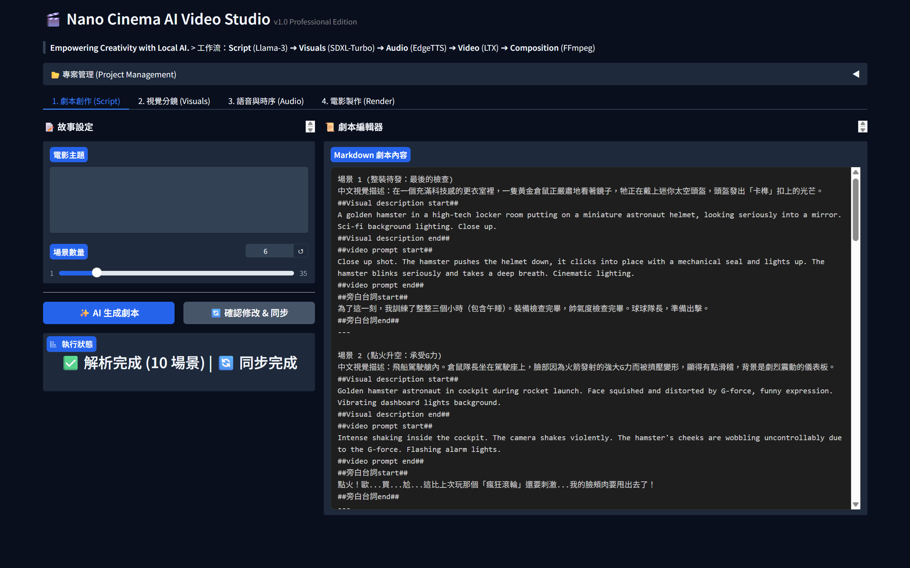 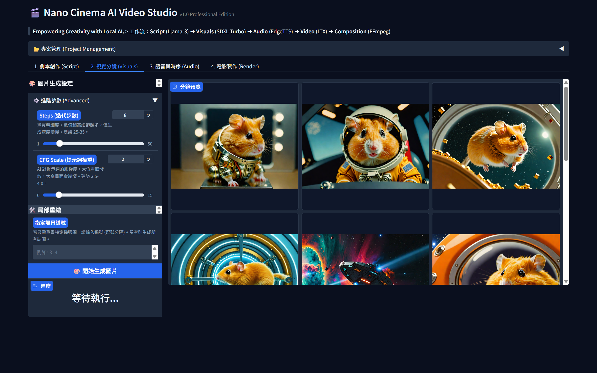
      <br><br>
      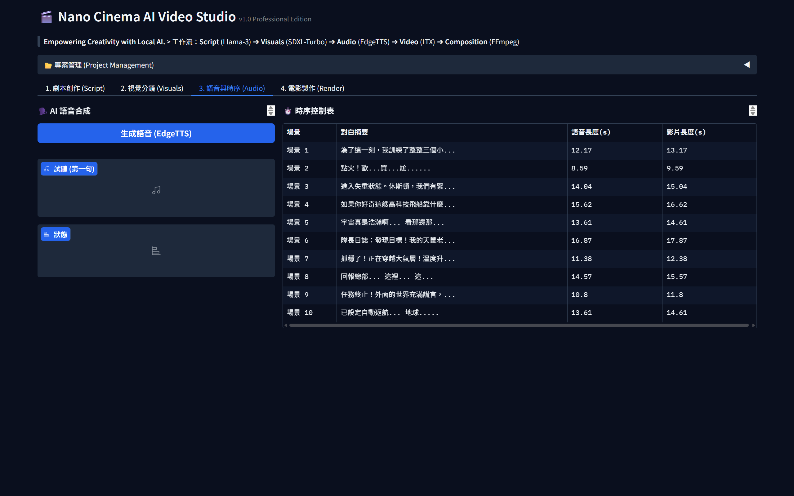 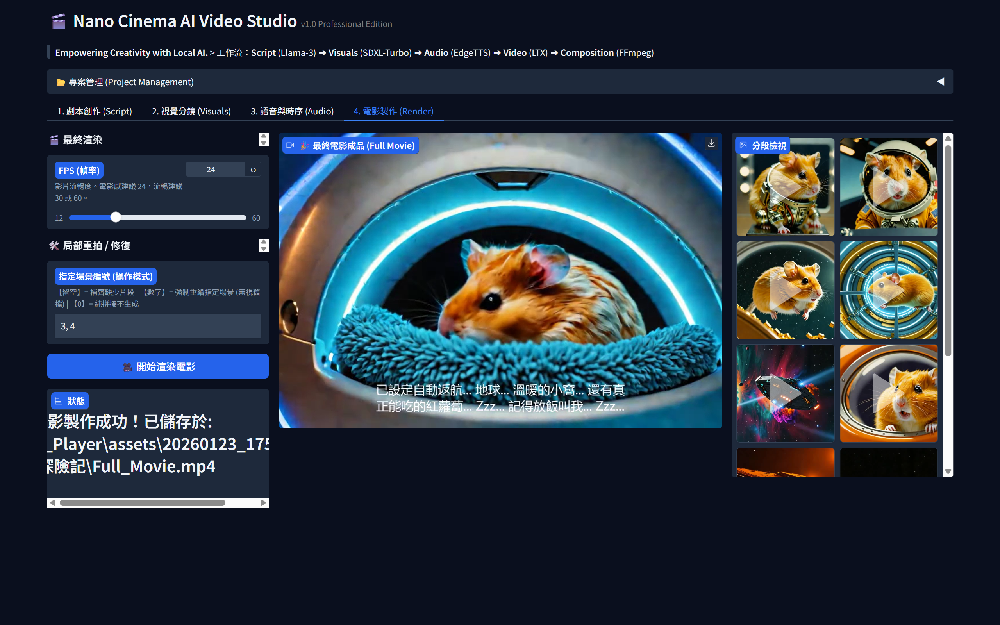
    </td>
  </tr>
</table>

### 2. The Flying Pig's Guide to Success: Find Your Wind! 🐷✈️
<table>
  <tr>
    <td width="65%" style="vertical-align: middle;">
      <video src="examples/2.mp4" controls width="100%"></video>
    </td>
    <td width="35%" style="vertical-align: middle;">
      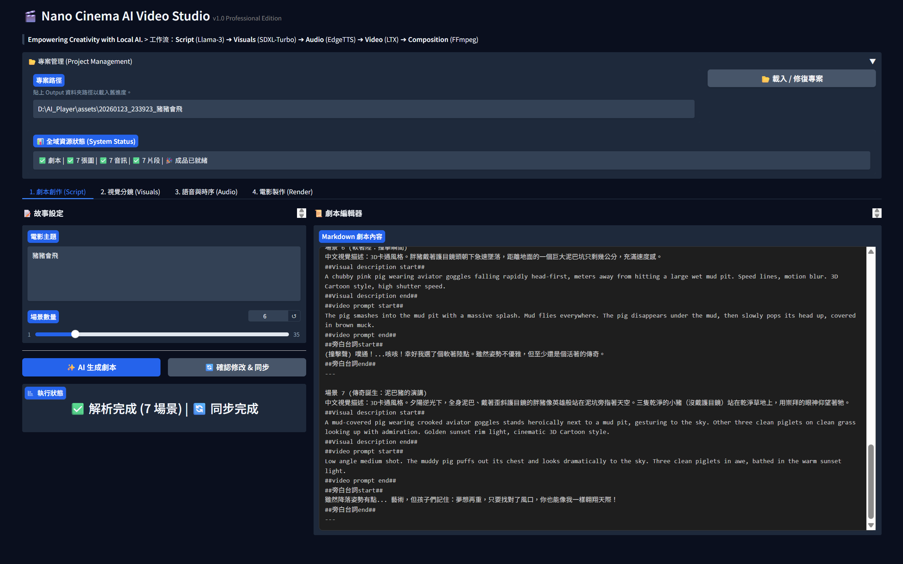 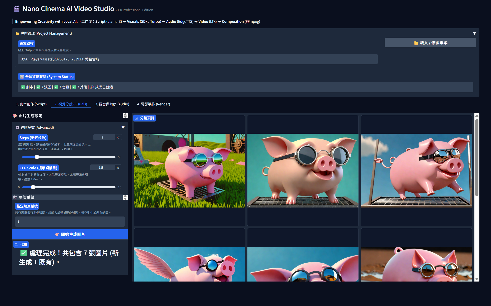
      <br><br>
      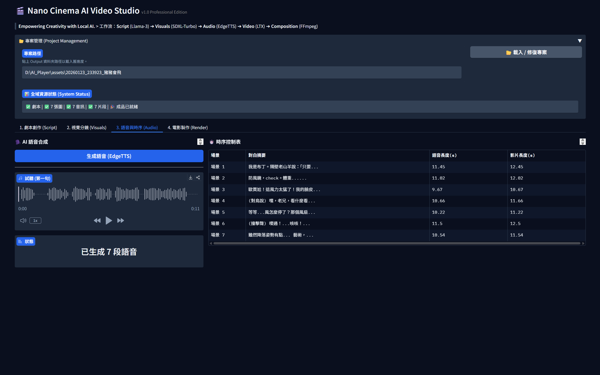 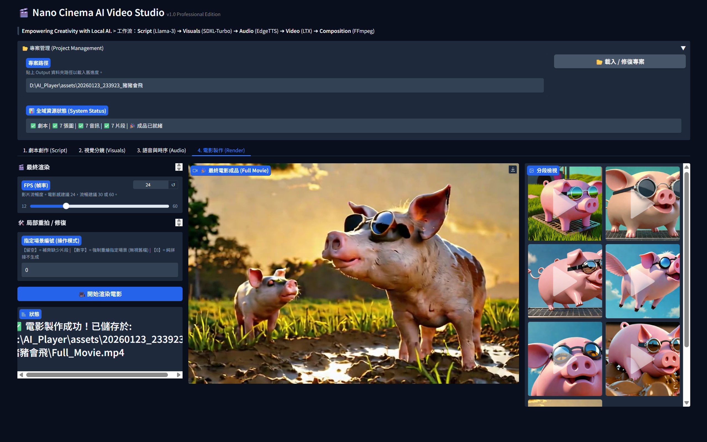
    </td>
  </tr>
</table>

### 3. More Demos 📺
Here are some additional generated results:

<table>
  <tr>
    <td width="33%"><video src="examples/3.mp4" controls width="100%"></video></td>
    <td width="33%"><video src="examples/4.mp4" controls width="100%"></video></td>
    <td width="33%"><video src="examples/5.mp4" controls width="100%"></video></td>
  </tr>
</table>
---

## 📷 UI Screenshot

Here is a walkthrough of the generation pipeline using the Gradio UI:

| **1. Script Generation** | **2. Image Generation** |
| :---: | :---: |
| 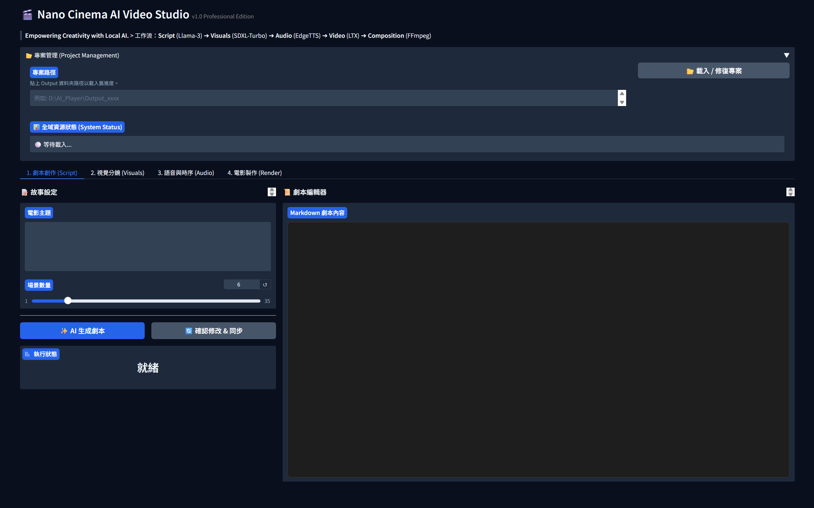 <br> *Generates scripts using Llama-3.3-70b* | 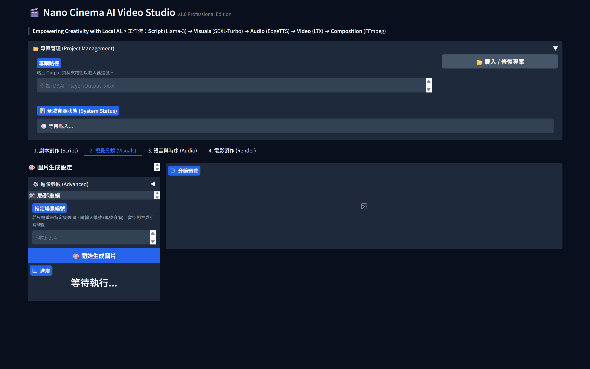 <br> *Visualizes scenes using SDXL-Turbo* |
| **3. Audio Generation** | **4. Video Generation** |
| 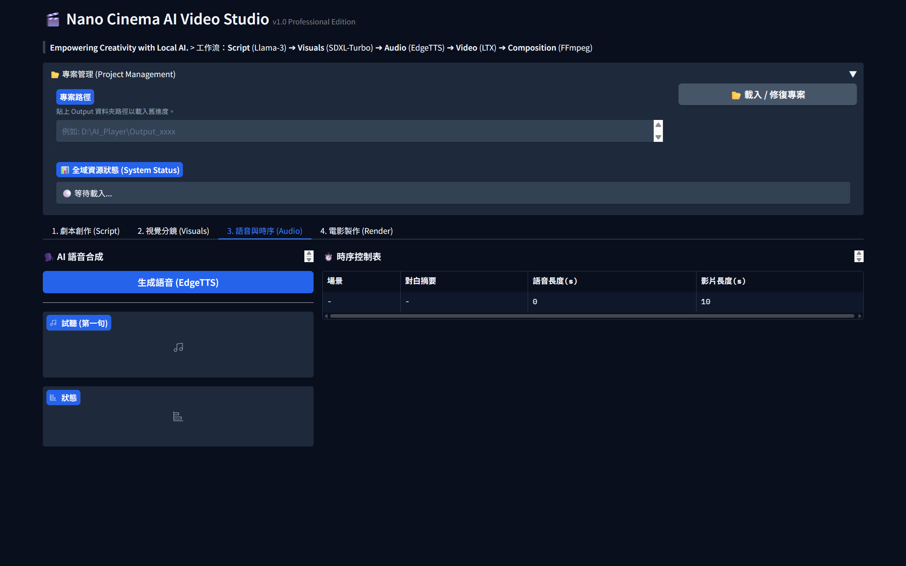 <br> *Synthesizes narration via EdgeTTS* | 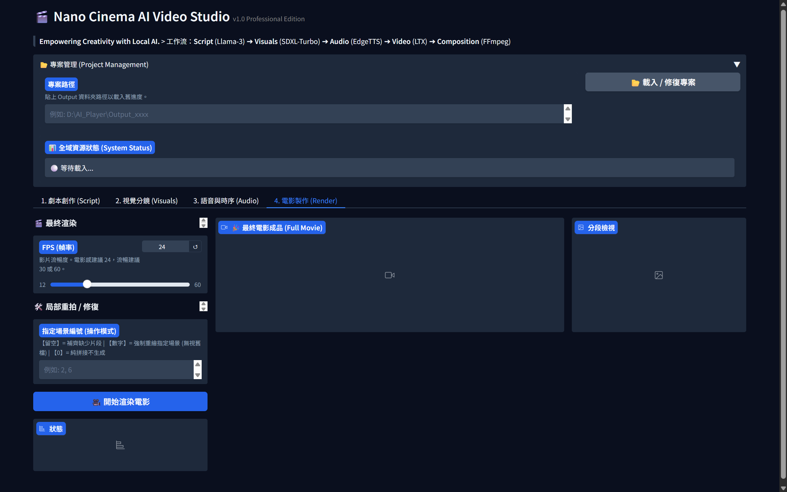 <br> *Animates video with LTX & FFmpeg* |

---

## 🌟 Background & Motivation

The 2025 Google I/O Developer Conference showcased groundbreaking advancements in AI, particularly the **Veo3 model** and **Flow platform**, demonstrating cinema-quality text-to-movie generation. While impressive, these proprietary tools often come with high costs or restricted access.

**Our Mission:**
The goal of **Nano Cinema AI Video Studio** is to **democratize AI video creation**. We aim to solve resource constraints by combining efficient open-source models to achieve a "free and unlimited" video production workflow that runs smoothly on consumer-grade hardware.

* ✅ **Hardware Tested:** NVIDIA GeForce RTX 4060 (8GB VRAM)
* ✅ **Result:** High-quality image and video generation without requiring enterprise-level GPUs.

---

## 🛠️ Technology Stack

We carefully selected components to balance **performance, cost, and speed**:

1.  **Script Generation: Llama-3.3-70b-versatile (via Groq)**
    * Utilizes Groq's LPU technology for lightning-fast, free inference. Llama-3.3 offers exceptional creative writing capabilities and multilingual support.

2.  **Image Generation: SDXL-Turbo**
    * Powered by Adversarial Diffusion Distillation (ADD), generating high-quality cinematic shots in just **1-4 steps**. Implemented via Hugging Face `diffusers`.

3.  **Audio Synthesis: EdgeTTS**
    * Accesses Microsoft Edge's natural-sounding speech synthesis. Requires **no API key**, no heavy downloads, and offers granular control over pitch and speed.

4.  **Video Generation: LTX (Image-to-Video)**
    * A breakthrough in local generative video. LTX offers low latency and high computational efficiency, making it possible to generate video clips on 8GB VRAM cards.

5.  **Interface: Gradio**
    * Provides a user-friendly Web UI for real-time preview, script editing, and partial re-rendering (inpainting/regeneration) support.

---

## 📦 Getting Started

Follow these steps to set up **Nano Cinema AI Video Studio** on your local machine. This project is designed to run completely offline using local resources.

### 📋 Prerequisites

* **Operating System:** Windows 10/11 (Recommended) or Linux.
* **Python:** Version 3.10 or higher.
* **GPU:** NVIDIA GeForce RTX 4060 or higher (VRAM 8GB+ is required, 12GB+ recommended for optimal LTX-Video performance).
* **FFmpeg:** Required for video processing and audio merging.

### 🛠️ Installation

**1. Clone the repository**

```bash
git clone https://github.com/wajason/Nano_Cinema_AI_Video_Studio.git
cd Nano_Cinema_AI_Video_Studio
```

**2. Set up a Virtual Environment**

It is highly recommended to use a virtual environment to manage dependencies to avoid conflicts.

* **Windows:**

    ```bash
    python -m venv venv
    .\venv\Scripts\activate
    ```

* **Linux / macOS:**

    ```bash
    python3 -m venv venv
    source venv/bin/activate
    ```

**3. Install Dependencies**

First, install PyTorch with CUDA support specifically for your GPU (this ensures GPU acceleration works correctly).

* **Example for CUDA 12.4:**

    ```bash
    pip install torch torchvision torchaudio --index-url https://download.pytorch.org/whl/cu124
    ```

    *(Note: Visit [pytorch.org](https://pytorch.org) to find the correct command for your specific CUDA version.)*

Then, install the rest of the project requirements:

```bash
pip install -r requirements.txt
```

### 📥 Model Setup

We provide an automated script to download the necessary model weights (SDXL-Turbo for images and LTX-Video for motion) directly into the project folder. This ensures relative paths work correctly without cluttering your global system drive.

**Run the download script:**

```bash
python download_models.py
```

> **Note:** This process will download several gigabytes of data into the `models/` directory. Please ensure you have sufficient disk space and a stable internet connection.

### ⚙️ FFmpeg Configuration

This studio requires FFmpeg to stitch video clips and audio tracks. You have two options:

* **Option A (System-wide):** Install FFmpeg and add it to your system's `PATH` environment variable.
* **Option B (Portable - Recommended for Windows):** Download `ffmpeg.exe` and `ffprobe.exe` (from [gyan.dev](https://www.gyan.dev/ffmpeg/builds/)) and place them directly inside the project root folder. The notebook is configured to detect them automatically.

### 🚀 Launching the Studio

Since this project is built as an interactive Jupyter Notebook (`.ipynb`), you need to launch it using Jupyter Lab or Notebook.

**Start Jupyter:**

```bash
jupyter lab
# OR
jupyter notebook
```

**Open the Notebook:**
In the browser window that opens, navigate to and click on `Nano_Cinema_AI_Video_Studio.ipynb`.

**Run the Application:**
Execute the cells sequentially from top to bottom. The final cell will launch the Gradio UI and provide a local URL (e.g., `http://127.0.0.1:7860`) where you can start creating movies.

---

## 📘 User Guide

Welcome to the **Nano Cinema Studio**. This guide distills thousands of hours of testing into a concise manual to help you master the AI models under the hood.

### 🧠 Part 1: Prompt Engineering

Unlike traditional LLMs, image and video generation models "think" visually, not linguistically. To get the best results from **SDXL-Turbo** and **LTX-Video**, you must unlearn standard writing habits and adapt to the model's logic.

#### 1. The "First Sentence" Rule
**SDXL-Turbo** has a short attention span. It places the highest weight on the first 10-20 tokens (roughly the first sentence).

* ❌ **Don't:** Start with atmosphere or setting (*"In a dark, lonely night, under the moonlight..."*)
* ✅ **Do:** Start with the **Subject** immediately. (*"A transparent plastic bag lying on the asphalt..."*)

> **Why?** If the subject isn't defined early, the model might hallucinate objects from the background description (e.g., drawing a moon instead of a bag).

#### 2. Concrete vs. Abstract
Generative models struggle with metaphors. They interpret words literally.

* ❌ **Metaphor:** "A bag dancing like a ballerina." (*Risk: The model might draw a bag with human legs*).
* ❌ **Emotion:** "A lonely and depressed atmosphere." (*Risk: Unpredictable color shifts or distorted faces*).
* ✅ **Physics:** "A bag twisting in the wind, spiral shape." (*Describes the shape, not the concept*).
* ✅ **Lighting:** "Cold blue lighting, single spotlight, long shadows." (*Creates the mood through physics*).

#### 3. The "Dual-Track" Strategy
This studio separates Image and Video prompts for a reason. **Do not mix them.**

* **🖼️ Image Prompts (for SDXL):** Focus on **Composition, Texture, and Lighting**.
    * *Keywords:* `Macro shot`, `8k`, `translucent texture`, `rim light`, `bokeh background`.
    * *Avoid:* Verbs that imply complex movement (e.g., "running", "exploding") can sometimes blur the static image.

* **🎥 Video Prompts (for LTX):** Focus on **Camera Movement and Physics**.
    * *Keywords:* `Slow camera zoom in`, `smooth continuous movement`, `floating`, `fluttering`, `wind blowing`.
    * *Tip:* LTX thrives on "Micro-movements" (e.g., breathing, blinking, drifting) rather than drastic action, which often leads to morphing artifacts.

#### 4. K.I.S.S. (Keep It Simple, Stupid)
Over-describing is the enemy.

* **Token Overload:** If you describe a *"red and white striped, vest-style, polyethylene carrier bag,"* the model may get confused and draw a striped vest.
* **Better:** *"A simple plastic shopping bag with red stripes."*
* **Rule of Thumb:** Let the model fill in the logical gaps. The more specific you get with industrial terms, the more likely the model will misunderstand.

---

### 🎛️ Part 2: Parameter Guide

This project uses **SDXL-Turbo**, a distilled model that behaves differently from the standard Stable Diffusion XL.

#### 1. Inference Steps
* **Standard SDXL:** Requires 20-50 steps.
* **Nano Cinema (Turbo):**
    * `1-2 Steps`: Fast but rough. Good for testing composition.
    * `6-8 Steps` **(Recommended)**: The "Sweet Spot". Provides excellent detail (e.g., semi-transparency, fur) without slowing down the system.
    * `>10 Steps`: Diminishing returns. Can sometimes lead to "burnt" (over-saturated) images or excessive contrast.

#### 2. CFG Scale
This controls how strictly the AI follows your prompt versus its own creativity.

* **Standard SDXL:** Usually ~7.0.
* **Nano Cinema (Turbo):** ⚠️ **CRITICAL: Keep it low!**
    * `0.0`: The model ignores your prompt entirely (Pure hallucination).
    * `1.5 - 2.5` **(Recommended)**: The optimal range for Turbo. It follows the prompt but keeps the image natural.
    * `> 3.0`: The image will likely "fry" (become pixelated, deep fried colors, or distorted).

#### 3. Video FPS
* **24 FPS:** The cinematic standard. Best for narrative films.
* *Tip:* Since LTX generates ~5-10 seconds of raw footage, using 24 FPS gives a good balance of smoothness and duration.

#### 4. Partial Regeneration
If a specific scene fails (e.g., Scene 3 has a glitch):

1. Go to the **"Visuals"** or **"Render"** tab.
2. Enter `3` in the **Target Scene** box.
3. Click **Generate**.

The system will only re-calculate Scene 3 and intelligently stitch it back with the existing valid files. This saves massive amounts of time compared to re-running the whole movie.

---

## 📦 Demo


https://github.com/user-attachments/assets/891979ca-4ddc-406e-a5fe-edb0a7cfd89c

https://github.com/user-attachments/assets/ee92e12f-9ec3-474d-9d5e-cc3e33f518d2

https://github.com/user-attachments/assets/9813c677-f94d-4465-8594-86b5877ef166

...
